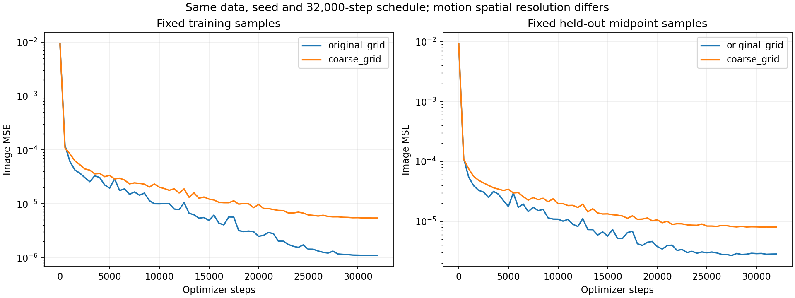
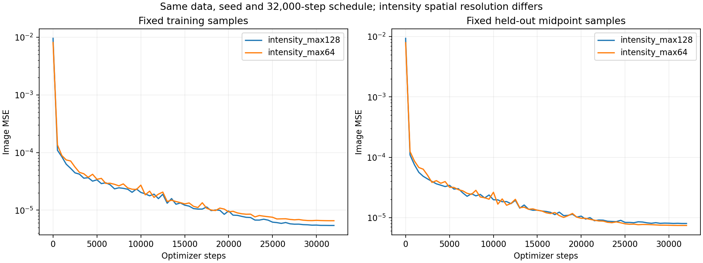
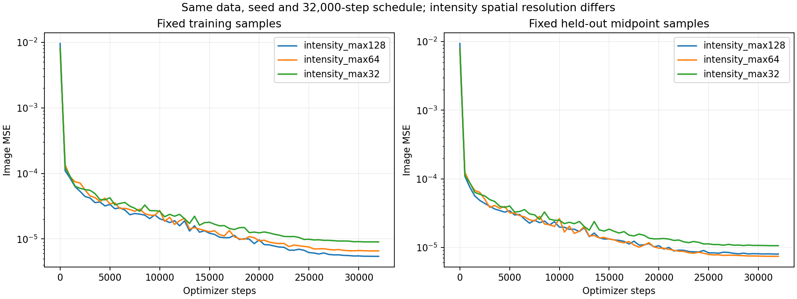

# Motion–Intensity Separation: Idea, Experiments, and Current Progress

Last updated: 2026-10-14.

**Goal: represent real dynamic objects for PACT reconstruction, including both motion and genuine intensity changes.** The phantom is an implementation and separation diagnostic, not the final target. No experiment below uses a PACT acoustic forward operator or real measurements yet. Known shapes, motion laws, and brightness curves are not built into the learned representation.

**Current status:** the local 24k-step hash sweep remains stopped at 10/36 runs. The second machine has published a separate complete 36/36 sweep on GitHub at `1d4265e`; see the remote-inventory update below. Compact records from all 36 second-machine runs are now included; their large artifacts were removed, and the subsequent history reset below removes the supported recovery path. The active Python implementation matches that remote version exactly. The local sweep's lowest aggregate intensity and motion errors come from motion 4 levels/max 32 with intensity 8 levels/max 64, but that local run's predicted intensity is nearly static. In the October 14 GIF review, the user rated the earlier single-cycle, 8k R=2 result as very good and preferred it as a visual reference; see Step 2. Lower aggregate error alone does not establish better recovery of intensity dynamics. Keep local and second-machine runs distinct, even when their configurations match.

**Prior completed comparison:** low-rank intensity improves some branch errors; more cycles, frames, and steps improve image fitting without recovering the true decomposition; larger motion grid cells improve branch errors but worsen image fitting. In the eight-level, 32k-step intensity-resolution comparison, max 64 gives the lowest midpoint image/intensity RRMSE among max 128, 64, and 32: 3.13% / 35.10%. Max 32 reduces motion RMSE further to 3.29 px, but image/intensity errors rise to 3.60% / 42.04%. These are single-seed toy results; intensity remains blurred and motion-effect GIFs retain local distortions. Reliable separation remains unresolved. R=2 is the working prototype, not an established rank bound for real objects.

This record collects the completed steps, their metrics, GIFs, loss histories, and limitations. Recent loss and input-coordinate ideas are marked as discussion only. Earlier simple-phantom, block-split, and temporal-L2 experiments are retained separately at the end.

## 1. Representation and Evaluation Conventions

Metric formulas and implementation status are collected in [METRICS.md](METRICS.md).
Its proposed changes are not an adopted protocol; the historical conventions below
remain in force for the saved results.

The nested model is

$$
\hat I(r,t)=C_\psi(q,t),\qquad q=r+u_\theta(r,t).
$$

| Quantity | Meaning |
|---|---|
| $r=(x,y)$ | Position in the current image |
| $u_\theta(r,t)$ | Backward displacement from the current image to reference coordinates |
| $q=r+u_\theta(r,t)$ | Position used to query the reference intensity |
| $C_\psi(q,t)$ | Reference intensity; intended to retain geometry while allowing real brightness changes |

Motion uses the reference anchor $u(r,t)=M(r,t)-M(r,t_0)$, with $t_0=-0.5$. Thus $u(r,t_0)=0$ exactly. This convention does not provide a true reference image to training. The original single-cycle domain is $x,y,t\in[-0.5,0.5]$; the multicycle prototype extends time to $[-0.5,2.5]$. Fixed domain bounds map hash inputs to $[0,1]$ and coordinate MLP inputs to $[-1,1]$. Motion is converted back to spatial coordinate units before addition.

The complex phantom contains an elliptical body and two bright spots, x/y translation, unequal x/y expansion, and global and local brightness variation. **Only observed image values supervise training.** True motion, reference intensity, and held-out image labels are used for evaluation only. A step is one optimizer update using a batch of 4,096 sampled space-time points, not one frame or one epoch.

Unless explicitly stated otherwise, the objective in the main sequence is

$$
\mathcal L_{\mathrm{image}}=\frac{1}{B}\sum_{i=1}^{B}
\left[C_\psi(r_i+u_\theta(r_i,t_i),t_i)-I_{\mathrm{obs}}(r_i,t_i)\right]^2.
$$

There is no branch ground-truth supervision or added regularization in those runs.

| Reported quantity | Interpretation |
|---|---|
| Image RRMSE | Global $\|\hat I-I\|_2/\|I\|_2$, reported as a percentage; lower is better |
| Reference intensity RRMSE | The same relative error for $C(q,t)$ on a fixed reference grid |
| Motion RMSE | Backward-displacement endpoint RMSE, including both components, in pixels over the true foreground |
| SSIM | Higher is better; block-split SSIM uses a different masked-window protocol and is reported separately |
| Batch loss | MSE on a newly sampled training batch before its update; not a held-out error |
| Fixed training / validation loss | MSE after the update on fixed sets of 65,536 samples, available from the multicycle runs onward |

Unless a table says otherwise, main metrics cover **all unseen midpoint frames**. Single-cycle and multicycle tables have different temporal domains; the matched first-cycle comparison below is used when comparing them directly. Auxiliary Jacobian diagnostics already present in saved results are retained, but are not a training loss or the primary separation criterion.

### How to Read the GIFs and Loss Curves

| View | What changes and what is held fixed |
|---|---|
| `image.gif` | Full predicted image versus observed truth |
| `reference_intensity.gif` | $C_{\mathrm{pred}}(q,t)$ on a fixed reference grid; exposes geometry retained by intensity |
| `motion_effect.gif` | True and predicted motion query the **same true time-varying intensity**; their difference isolates motion error, but the images still include real brightness changes |
| `motion_only.gif` | Freeze learned intensity at $t_0$ and show $C_{\mathrm{pred}}(r+u_{\mathrm{pred}}(r,t),t_0)$; the first panel is intentionally static, and the third is change from that reference, not ground-truth error |

The static panel in `motion_only.gif` is therefore not a claim that true motion is static. Use `motion_effect.gif` for the truth comparison, and `motion_only.gif` for the learned branch's effect without requiring true intensity.

Early runs saved 17 batch-loss observations (step 1 and every 500 steps through 8,000). Their linked **logged loss curves were rendered retrospectively from the original CSVs for this update**, with no smoothing or retraining. Fixed-sample loss and learning-rate histories were not recorded for these runs and have not been invented. Later `loss_curve.png` plots contain the recorded fixed losses and per-group learning rates; CSV learning rates refer to the next update after the scheduler step.

### Metrics documentation audit, 2026-10-14

Documented the recommended metric formulas and audited existing implementations in
[METRICS.md](METRICS.md), with links from both reading guides. Scalar and component
RRMSE/PSNR/SSIM, vector RRMSE, pixel EPE, and endpoint RMSE already exist. Dynamic
intensity RRMSE, physical/FOV-unit outputs, and a unified mean spatial-frame SSIM
summary remain proposals. Confirmed saved R=2 metric fields and passed 11 existing
focused tests. No evaluation code, historical results, or training was changed.

The user subsequently confirmed that motion accuracy should be measured directly
against the true displacement field. Warping true intensity is for visualization
only; its image error is not a motion-accuracy metric. Recorded this distinction
in the metric specification without changing code or historical outputs.

## 2. Step 1 — Establish Image Fitting and Diagnose the Original Nested Model

**Idea.** First check whether a nested representation can fit the images, then evaluate whether its two branches recover their intended physical roles.

**Completed.** Implemented Direct Hash NF, Nested MLP, and Nested Hash NF; shared normalization, image-MSE training, prediction saving, midpoint evaluation, branch replacement, and GIF generation. The complex baseline uses 64×64 images, 64 training times, 63 unseen midpoint times, seed 0, 8,000 steps, and batch size 4,096.

| Model | Parameters | Image RRMSE ↓ | Image SSIM ↑ | Motion RMSE ↓ | Intensity RRMSE ↓ | Final logged batch MSE |
|---|---:|---:|---:|---:|---:|---:|
| Direct Hash NF | 323,401 | 4.03% | 0.999169 | — | — | 5.26969e-9 |
| Nested MLP | 34,915 | 13.53% | 0.984384 | 6.553 px | 98.72% | 1.74070e-4 |
| Nested Hash NF | 646,867 | 3.40% | 0.999436 | 6.421 px | 98.99% | 4.20245e-9 |

A zero-motion prediction has **6.066 px** foreground RMSE on this test set. Neither nested baseline improves on it. Parameter counts differ, so this is not an equal-capacity comparison.

| Model | Metrics | Image GIF | Intensity GIF | Motion versus truth | Loss curve / numeric history |
|---|---|---|---|---|---|
| Direct Hash NF | [JSON](results/complex/hash_nf/summary.json) | GIF (historical reference; artifact not retained) | — | — | [Curve](results/complex/hash_nf/plots/logged_loss_curve.png) / [CSV](results/complex/hash_nf/loss.csv) |
| Nested MLP | [JSON](results/complex/nested_mlp/summary.json) | GIF (historical reference; artifact not retained) | GIF (historical reference; artifact not retained) | GIF (historical reference; artifact not retained) | [Curve](results/complex/nested_mlp/plots/logged_loss_curve.png) / [CSV](results/complex/nested_mlp/loss.csv) |
| Nested Hash NF | [JSON](results/complex/nested_hash_nf/summary.json) | GIF (historical reference; artifact not retained) | GIF (historical reference; artifact not retained) | GIF (historical reference; artifact not retained) | [Curve](results/complex/nested_hash_nf/plots/logged_loss_curve.png) / [CSV](results/complex/nested_hash_nf/loss.csv) |

**Key diagnosis.** The intensity branch still moves and expands. Maximum residual translation is 8.44 px for MLP and 7.51 px for Hash; maximum x-size ratios are 1.36 / 1.38 and y-size ratios 1.54 / 1.58, relative to the first midpoint. These are approximate known-shape fits used only for toy evaluation; their median fitting RRMSEs are 13.27% / 11.45%. Predicted foreground motion RMS is only 0.82 / 1.01 px, versus 6.07 px for truth.

| Nested Hash NF branch replacement | Image RRMSE |
|---|---:|
| Predicted motion + predicted intensity | 3.40% |
| Motion disabled + predicted intensity | 26.00% |
| Predicted motion + true intensity | 77.51% |
| True motion + predicted intensity | 101.31% |

**Conclusion.** Motion contributes to fitting, but the branches compensate for one another. Small image loss does not establish correct decomposition. These diagnostics evaluate the existing checkpoints; they are not additional training runs.

Phantom GIF (historical reference; artifact not retained) · [Full branch diagnostics](results/complex/midpoint_branch_diagnostics/README.md) · Intensity geometry (historical reference; artifact not retained) · Motion outputs (historical reference; artifact not retained) · Framewise image metrics (historical reference; artifact not retained).

## 3. Step 2 — Restrict Intensity to Rank 2 or 3

**Idea.** Reduce the intensity branch's ability to explain arbitrary moving geometry while retaining spatially varying brightness changes:

$$
C_\psi(q,t)=\sum_{k=1}^{R}b_k(q)a_k(t).
$$

**Completed.** A 2D spatial hash network outputs R bases; a `1 → 32 → 32 → R` Tanh MLP outputs temporal coefficients. Their direct inner product is the intensity. R is the **total rank, including static intensity**; there is no extra static residual or nonlinear layer after the product. The motion branch, reference anchor, single-cycle data, seed, 8k budget, and image-MSE loss are retained.

| Model | Parameters | Image RRMSE ↓ | Motion RMSE ↓ | Intensity RRMSE ↓ | Final logged batch MSE |
|---|---:|---:|---:|---:|---:|
| Original Nested Hash NF | 646,867 | 3.40% | 6.421 px | 98.99% | 4.20245e-9 |
| Low-rank R=2 | 390,934 | 5.16% | 4.775 px | 46.65% | 8.07758e-8 |
| Low-rank R=3 | 391,032 | 5.31% | 4.817 px | 52.04% | 1.19588e-7 |

| Rank | Metrics | Image GIF | Intensity GIF | Motion versus truth / motion alone | Loss curve / numeric history |
|---|---|---|---|---|---|
| 2 | [JSON](results/complex/low_rank/rank_2/summary.json) | GIF (historical reference; artifact not retained) | GIF (historical reference; artifact not retained) | Truth comparison (historical reference; artifact not retained) / Motion alone (historical reference; artifact not retained) | [Curve](results/complex/low_rank/rank_2/plots/logged_loss_curve.png) / [CSV](results/complex/low_rank/rank_2/loss.csv) |
| 3 | [JSON](results/complex/low_rank/rank_3/summary.json) | GIF (historical reference; artifact not retained) | GIF (historical reference; artifact not retained) | Truth comparison (historical reference; artifact not retained) / Motion alone (historical reference; artifact not retained) | [Curve](results/complex/low_rank/rank_3/plots/logged_loss_curve.png) / [CSV](results/complex/low_rank/rank_3/loss.csv) |

**Key result.** R=2 is slightly better on all three main errors in this single-seed comparison and was selected for the next prototype. Estimated residual intensity translation falls to 0.23 / 0.38 px, but intensity becomes blurred; known-shape fit residuals rise to 30.31% / 33.32%. Branch replacement errors remain large: predicted motion + true intensity gives 26.20% / 30.93%; true motion + predicted intensity gives 47.79% / 55.12% (R=2 / R=3). Existing auxiliary nonpositive-Jacobian fractions are 28.48% / 28.81%, indicating local folding. Reduced residual translation is not sufficient evidence of true intensity recovery.

**User visual review, 2026-10-14.** The user rated the fourth GIF in the comparison, the original R=2 intensity GIF (historical reference; artifact not retained), as very good and preferred it to the later low-error examples. Retain this exact run as an important visual reference. Its [saved configuration](results/complex/low_rank/rank_2/config.json) uses 64x64 images, one cycle, 64 training frames, 8,000 steps, batch 4,096 and seed 0. Both encoders have eight levels with resolutions `[8, 11, 17, 26, 39, 57, 86, 128]`, two features per level and a per-level table capacity of 2^15: motion encodes `(x,y,t)` and intensity encodes only reference `(qx,qy)`. Both hash heads are `16 -> 64 -> 64 -> 2` ReLU MLPs; intensity coefficients use a separate `1 -> 32 -> 32 -> 2` Tanh MLP. Adam uses initial hash/MLP learning rates 0.01/0.001 with cosine decay to zero. Total rank is two, the reference time is -0.5, and training uses image MSE alone. These settings were checked against the saved configuration and archived source; no model or training settings were changed.

The visual preference is not a claim that the temporal waveform is correct or separation is complete. The later 24k run `mL4_max32_iL8_max64`, despite 28.58% aggregate intensity RRMSE, has center brightness only 0.3315-0.3386 versus truth 0.21-0.35, and spot brightness 0.7879-0.8300 versus truth 0.4056-0.9744 on saved midpoint arrays. Its existing time curves (historical reference; artifact not retained) confirm that true brightness oscillations are largely missing. The early R=2 run preserves more temporal variation, but matching its timing and amplitude to truth remains unresolved. No new experiment or evaluation protocol was approved or run in this review.

**Validation completed.** All 50 tests passed, including rank, interpolation, coordinate gradients, updates through the nested model, physical coordinate units, and checkpoint restoration. Both trained models have exactly zero reference-time motion at 4,096 points; 511 reloaded predictions per model match saved arrays exactly. Relative intensity-matrix rank tails beyond R are 3.62e-8 / 4.22e-8 in float32. Each run's 41 source-snapshot files passed hash verification. Concurrent CPU runtimes are not used for speed claims.

[Validation record](results/complex/low_rank/verification.json) · [Test log](results/complex/low_rank/validation.log) · [Branch diagnostics](results/complex/low_rank/branch_diagnostics/README.md).

## 4. Step 3 — Increase Both Cycle Repetition and Frame Density

**Question.** Is the original time interval or temporal sampling insufficient for separation?

**Completed.** Established a new R=2 prototype with 3 complete common cycles over [-0.5,2.5], 379 training times, and 378 unseen midpoint times. There are 126 intervals per cycle, twice the original density. Spatial size remains 64×64; dynamics, intensity/motion capacity, image MSE, reference anchor, seed 0, and batch 4,096 are retained. The first new run uses 8,000 steps.

Its full three-cycle midpoint results are **2.46% image RRMSE, 5.473 px motion RMSE, and 63.87% intensity RRMSE**. To compare with the old model without mixing time domains or test times, existing analysis also queried both models at 126 shared unseen times in the first cycle:

| Model, evaluated at the same 126 times | Image RRMSE ↓ | Motion RMSE ↓ | Intensity RRMSE ↓ |
|---|---:|---:|---:|
| Original 1 cycle / 64 times / 8k | 4.01% | 4.780 px | 46.65% |
| New 3 cycles / 379 times / 8k | 2.92% | 5.015 px | 46.01% |

**Conclusion.** Image fitting improves on these shared times, but motion separation does not. Cycle count and density changed together, so their effects cannot be separated. Global time normalization is retained with unchanged temporal hash resolution, so each physical cycle occupies less of the normalized domain. This experiment does not isolate a pure benefit from repeated motion or demonstrate real-object performance.

**Loss monitoring added.** Every future run through the shared entry point saves numeric batch loss, fixed-sample training and held-out MSE, and per-group learning rates, with PNG/SVG curves. Monitoring uses an independent sampling generator and no validation gradients; model, optimizer, scheduler, and RNG states can be saved at checkpoints. Final fixed training / validation MSE for the 8k run is **4.02896e-6 / 4.96784e-6**.

New phantom GIF (historical reference; artifact not retained) · [Configuration](experiments/complex/low_rank_multicycle.json) · [Metrics](results/complex/low_rank_multicycle/steps_8000/summary.json) · [Matched-time comparison](results/complex/low_rank_multicycle/comparison.json).

| Image | Intensity | Motion versus truth | Motion alone | Loss and learning rates | Numeric loss |
|---|---|---|---|---|---|
| GIF (historical reference; artifact not retained) | GIF (historical reference; artifact not retained) | GIF (historical reference; artifact not retained) | GIF (historical reference; artifact not retained) | [Curve](results/complex/low_rank_multicycle/steps_8000/plots/loss_curve.png) | [CSV](results/complex/low_rank_multicycle/steps_8000/loss.csv) |

## 5. Step 4 — Test a Longer Training Budget

**Question.** Is poor separation mainly due to insufficient optimization?

**Completed.** Trained the same multicycle R=2 prototype from seed 0 for 32,000 steps. The independent 8k and 32k runs each use a cosine schedule ending at their own budget; the 32k run is not a continuation from the 8k run's zero learning rate. Initial fixed-sample losses are identical.

| Independent run | Image RRMSE ↓ | Motion RMSE ↓ | Intensity RRMSE ↓ | Final fixed training MSE | Final fixed validation MSE |
|---|---:|---:|---:|---:|---:|
| 8,000 steps | 2.46% | 5.473 px | 63.87% | 4.02896e-6 | 4.96784e-6 |
| 32,000 steps | 1.88% | 5.484 px | 68.66% | 1.09396e-6 | 2.83704e-6 |

The saved checkpoints also separate progress within the longer schedule from the independent 8k run:

| Checkpoint within the 32k schedule | Image RRMSE ↓ | Motion RMSE ↓ | Intensity RRMSE ↓ |
|---|---:|---:|---:|
| 8k | 4.20% | 5.422 px | 65.47% |
| 16k | 2.51% | 5.483 px | 69.28% |
| 24k | 1.96% | 5.485 px | 68.62% |
| 32k | 1.88% | 5.484 px | 68.66% |

**Conclusion.** More optimization improves image fitting but does not recover the true branches. Fixed validation MSE decreases overall without sustained deterioration; there is no observed sustained validation-loss increase over this run. The late plateau coincides with the learning rate approaching zero, so it does not prove full convergence or that any longer training must fail. The evidence rules out a simple explanation that increasing the budget alone, in this setup, fixes separation.

On the same 126 first-cycle test times used above, the 32k model gives 2.39% image RRMSE, 5.239 px motion RMSE, and 61.48% intensity RRMSE. This also shows improved image fitting without better branch recovery.


| Metrics | Image | Intensity | Motion versus truth / motion alone | Loss and learning rates / numeric history |
|---|---|---|---|---|
| [JSON](results/complex/low_rank_multicycle/steps_32000/summary.json) | GIF (historical reference; artifact not retained) | GIF (historical reference; artifact not retained) | Truth comparison (historical reference; artifact not retained) / Motion alone (historical reference; artifact not retained) | [Curve](results/complex/low_rank_multicycle/steps_32000/plots/loss_curve.png) / [CSV](results/complex/low_rank_multicycle/steps_32000/loss.csv) |

**Validation for Steps 3–4.** All 53 tests and small midpoint/block end-to-end checks passed. Monitoring does not change training weights or sampling state. Both models satisfy the reference anchor exactly, reproduce 511 sampled predictions after reload, and have finite coordinate gradients and rank-2 tails around 3.5e-8. Each source snapshot's 43 files passed hash verification. The existing auxiliary nonpositive-Jacobian fractions remain around 32%.

[Full results](results/complex/low_rank_multicycle/README.md) · Branch convergence (historical reference; artifact not retained) · [Checkpoint metrics](results/complex/low_rank_multicycle/checkpoint_metrics.json) · [Validation](results/complex/low_rank_multicycle/verification.json) · [Test log](results/complex/low_rank_multicycle/validation.log).

## 6. Step 5 — Use Coarser Spatial Grids for Motion

**Idea.** Reduce the motion branch's spatial detail without adding a regularization loss or imposing the phantom's motion formula.

**Completed.** Reduced motion x/y grid limits from 8–128 to 2–32 across eight levels, making cells approximately four times wider. Motion time resolution stays 8–128, as does the intensity spatial grid. R=2, the three-cycle data, 379 training times, seed 0, batch 4,096, reference anchor, image MSE, and 32k cosine schedule are retained. Hash features are interpolated before the MLP; this is not a strict displacement bandwidth or invertibility constraint.

| Metric | Original motion grid | Coarse motion grid |
|---|---:|---:|
| Midpoint image RRMSE ↓ | 1.877% | 3.141% |
| Midpoint motion RMSE ↓ | 5.484 px | 4.339 px |
| Midpoint intensity RRMSE ↓ | 68.656% | 55.064% |
| Final fixed training MSE | 1.09396e-6 | 5.43553e-6 |
| Final fixed validation MSE | 2.83704e-6 | 7.99252e-6 |
| Total parameters | 390,934 | 241,942 |
| Motion parameters | 323,466 | 174,474 |
| Matched CPU forward/backward per 4,096 queries | 25.61 ms | 26.13 ms |

| Coarse-model checkpoint within the 32k schedule | Image RRMSE ↓ | Motion RMSE ↓ | Intensity RRMSE ↓ |
|---|---:|---:|---:|
| 8k | 5.427% | 4.134 px | 52.514% |
| 16k | 3.802% | 4.289 px | 54.633% |
| 24k | 3.285% | 4.339 px | 54.276% |
| 32k | 3.141% | 4.339 px | 55.064% |

**Conclusion.** Motion error improves by about 20.9% and intensity error by 19.8% relative to the original-grid 32k baseline, while image error increases. Intensity remains blurred; within the coarse run, continued image improvement accompanies slightly worse branch errors. Reliable separation is still not recovered. The existing auxiliary nonpositive-Jacobian fraction is 29.85%, versus 32.21% in the baseline.

**Cost and comparison limits.** Total parameters fall 38.1%, but matched timing shows no speedup. Timing uses four CPU threads, ten warmups, and six alternating rounds of 25 repetitions; it excludes Adam, monitoring, evaluation, and the PACT operator. Historical full-run runtimes had different concurrent workloads and are not a controlled comparison. Initial intensity parameters are identical, but changed motion table sizes alter subsequent RNG consumption, so motion hidden weights and training batches are not identical despite the same seed.



| Metrics | Image | Intensity | Motion versus truth / motion alone | Loss and learning rates / numeric history |
|---|---|---|---|---|
| [JSON](results/complex/low_rank_coarse_motion/steps_32000/summary.json) | GIF (historical reference; artifact not retained) | GIF (historical reference; artifact not retained) | Truth comparison (historical reference; artifact not retained) / Motion alone (historical reference; artifact not retained) | [Curve](results/complex/low_rank_coarse_motion/steps_32000/plots/loss_curve.png) / [CSV](results/complex/low_rank_coarse_motion/steps_32000/loss.csv) |

**Validation completed.** All 60 tests and a three-step smoke run passed. Checks cover rectangular-grid interpolation, coordinate gradients, unchanged temporal resolution and intensity initialization, rank, anchor, and checkpoint round trips. The final anchor is exactly zero at 4,096 points; 511 reloaded predictions match saved arrays; rank-2 tails are 3.58e-8; all 45 source files match their hashes. Final model/checkpoint consistency, shared monitoring samples, and zero final learning rates were verified.

[Configuration](experiments/complex/low_rank_coarse_motion.json) · [Full results](results/complex/low_rank_coarse_motion/README.md) · [Checkpoint metrics](results/complex/low_rank_coarse_motion/checkpoint_metrics.json) · Branch convergence (historical reference; artifact not retained) · [Timing](results/complex/low_rank_coarse_motion/timing.json) · [Validation](results/complex/low_rank_coarse_motion/verification.json) · [Test log](results/complex/low_rank_coarse_motion/validation.log).

## 7. Step 6 — Test Intensity Maximum Resolution 64

**Completed.** Reduced only the intensity hash-grid maximum resolution from 128 to 64, keeping eight levels and minimum resolution 8. The motion spatial/time grids remain 2–32 / 8–128. R=2, three cycles, 379 frames, 32k steps, seed 0, batch 4,096, learning rates, cosine schedule, image MSE, reference anchor, and fixed monitoring samples retain the Step 5 settings. The eight intensity resolutions become `[8, 10, 14, 19, 26, 35, 47, 64]`; changing the upper limit also redistributes intermediate levels. The [configuration](experiments/complex/low_rank_intensity_max64.json) differs from the Step 5 configuration only in `encoding.max_resolution`.

| Metric | Intensity max 128 (Step 5) | Intensity max 64 |
|---|---:|---:|
| Midpoint image RRMSE ↓ | 3.141% | 3.126% |
| Midpoint intensity RRMSE ↓ | 55.064% | 35.103% |
| Midpoint motion RMSE ↓ | 4.339 px | 3.898 px |
| Final fixed training MSE | 5.43553e-6 | 6.57026e-6 |
| Final fixed validation MSE | 7.99252e-6 | 7.40359e-6 |
| Total parameters | 241,942 | 199,800 |
| Intensity parameters | 67,468 | 25,326 |
| Motion parameters | 174,474 | 174,474 |

| Max-64 checkpoint within the 32k schedule | Image RRMSE ↓ | Intensity RRMSE ↓ | Motion RMSE ↓ |
|---|---:|---:|---:|
| 8k | 5.712% | 36.477% | 3.765 px |
| 16k | 3.872% | 35.677% | 3.870 px |
| 24k | 3.283% | 35.128% | 3.894 px |
| 32k | 3.126% | 35.103% | 3.898 px |

**Result and limits.** The max-64 configuration reduces final intensity error by 36.25% and motion error by 10.16% relative to max 128, while image RRMSE is nearly unchanged. Total parameters decrease 17.42%. Intensity remains visibly blurred, with unresolved small spots and boundaries; motion-versus-truth comparisons still show deformation errors. Within the max-64 run, later training improves image fitting and intensity error slightly while motion error increases. This supports investigating intensity spatial capacity but does not identify resolution 128 as the sole cause of separation failure. Different parameter shapes consume a different random-number sequence, so equal seeds do not imply identical branch initialization or training batches. This is one seed on toy image supervision, without real PACT measurements or a controlled speed comparison. No additional seed, loss change, or new default is implied.



| Metrics | Image | Intensity | Motion versus truth / motion alone | Loss and learning rates / numeric history |
|---|---|---|---|---|
| [JSON](results/complex/low_rank_intensity_max64/steps_32000/summary.json) | GIF (historical reference; artifact not retained) | GIF (historical reference; artifact not retained) | Truth comparison (historical reference; artifact not retained) / Motion alone (historical reference; artifact not retained) | [Curve](results/complex/low_rank_intensity_max64/steps_32000/plots/loss_curve.png) / [CSV](results/complex/low_rank_intensity_max64/steps_32000/loss.csv) |

**Validation.** All 60 existing tests and four comparison-guard tests passed. A three-step, 25-frame CPU smoke run and the shared comparison pipeline passed. An earlier four-frame smoke run completed training but failed when printing null SSIM because three midpoint frames are shorter than the unchanged seven-sample SSIM window; the error log is preserved and no metric definition was changed. The trained model has zero reference-time motion at 4,096 points, finite nonzero spatial coordinate gradients, and rank-2 tails of 3.42e-8 / 3.41e-8. All 511 sampled reloaded predictions match saved arrays exactly; final model and final intermediate checkpoint match. All 48 source-snapshot files pass hash checks. Fixed monitoring indices match the baseline; final monitored losses and saved image/intensity RRMSE were recomputed. All five final learning rates are zero, and 66 loss records are saved. Four GIFs each contain 378 frames at 90 ms; the motion truth panel has 126 distinct images and moves. The max-128 checkpoint metrics recompute identically to the previous report.

[Comparison JSON](results/complex/low_rank_intensity_max64/comparison.json) · [Checkpoint metrics](results/complex/low_rank_intensity_max64/checkpoint_metrics.json) · Branch convergence (historical reference; artifact not retained) · [Validation](results/complex/low_rank_intensity_max64/verification.json) · [Validation source](results/complex/low_rank_intensity_max64/validation_sources.zip) · [Launch record](results/complex/low_rank_intensity_max64/launch.json).

Reproduce from the repository root in the existing `nf-crt` environment, choosing a fresh output directory for training:

```bash
python -m motion_static.run --phantom complex --model nested_low_rank_hash_nf \
  --config motion_static/experiments/complex/low_rank_intensity_max64.json \
  --out motion_static/results/complex/low_rank_intensity_max64/steps_32000
python -m motion_static.evaluation.compare_training \
  motion_static/results/complex/low_rank_coarse_motion/steps_32000 \
  motion_static/results/complex/low_rank_intensity_max64/steps_32000 \
  --out motion_static/results/complex/low_rank_intensity_max64 \
  --vary-intensity-grid --labels intensity_max128 intensity_max64
```

## 8. Step 7 — Compare Intensity Maximum Resolutions 32, 64, and 128

**Completed.** Reduced only `encoding.max_resolution` from 64 to 32. R=2, eight intensity levels with minimum resolution 8, the motion grid, three cycles and 379 frames, seed 0, batch size 4,096, 32k steps, all learning rates, the cosine schedule, image-MSE loss, reference anchor, and monitoring conventions remain unchanged. The [configuration](experiments/complex/low_rank_intensity_max32.json) produces intensity resolutions `[8, 9, 11, 14, 17, 21, 26, 32]`. The run used the same local `nf-crt` CPU environment with four threads; the max-64 and max-128 models were reused without retraining.

| Metric | Intensity max 128 | Intensity max 64 | Intensity max 32 |
|---|---:|---:|---:|
| Midpoint image RRMSE ↓ | 3.141% | **3.126%** | 3.604% |
| Midpoint intensity RRMSE ↓ | 55.064% | **35.103%** | 42.037% |
| Midpoint motion RMSE ↓ | 4.339 px | 3.898 px | **3.295 px** |
| Final fixed training MSE ↓ | **5.43553e-6** | 6.57026e-6 | 9.01445e-6 |
| Final fixed validation MSE ↓ | 7.99252e-6 | **7.40359e-6** | 1.05910e-5 |
| Total parameters | 241,942 | 199,800 | 187,390 |
| Intensity parameters | 67,468 | 25,326 | 12,916 |

| Max-32 checkpoint within the 32k schedule | Image RRMSE ↓ | Intensity RRMSE ↓ | Motion RMSE ↓ |
|---|---:|---:|---:|
| 8k | 5.656% | 44.603% | 3.227 px |
| 16k | 4.429% | 43.199% | 3.271 px |
| 24k | 3.814% | 42.531% | 3.286 px |
| 32k | 3.604% | 42.037% | 3.295 px |

**Result and limits.** Compared with max 64, max 32 lowers final displacement RMSE by 15.49%, but increases intensity RRMSE by 19.75% and image RRMSE from 3.13% to 3.60%. Max 64 has the lowest image/intensity errors in this three-run comparison; max 32 has the lowest displacement RMSE. Intensity remains blurred, and the motion-effect GIF still contains substantial local distortions despite lower displacement RMSE. Later max-32 training improves image/intensity fitting while motion error rises slightly. Loss curves flatten late in the fixed cosine schedule; this does not prove that all optimization possibilities are exhausted. These results do not establish a monotonic benefit from lowering resolution or resolve physical separation. This is a single-seed toy comparison: changing parameter shapes changes RNG consumption, initialization, and training batches. No claim about real PACT performance or controlled speed is made, and no further run or default change is selected.



The new [comparison renderer](evaluation/compare_gifs.py) reads saved arrays. Each animation places ground truth, max 128, max 64, and max 32 at identical times, with fixed 0–1 prediction scales and one absolute-error scale shared across runs and frames. Motion panels all query the same true time-varying intensity, preserving the existing diagnostic definition. PNG previews use the time of maximum mean frame MSE across the compared runs.

| Three-run image comparison | Three-run intensity comparison | Three-run motion comparison | Loss and branch curves |
|---|---|---|---|
| GIF (historical reference; artifact not retained) | GIF (historical reference; artifact not retained) | GIF (historical reference; artifact not retained) | [Loss](results/complex/low_rank_intensity_max32/loss_comparison.png) / Branch metrics (historical reference; artifact not retained) |

Max-32 outputs: [metrics](results/complex/low_rank_intensity_max32/steps_32000/summary.json), image GIF (historical reference; artifact not retained), intensity GIF (historical reference; artifact not retained), motion versus truth (historical reference; artifact not retained), motion alone (historical reference; artifact not retained), [loss and learning-rate curves](results/complex/low_rank_intensity_max32/steps_32000/plots/loss_curve.png), and [numeric history](results/complex/low_rank_intensity_max32/steps_32000/loss.csv).

**Validation.** Four comparison-guard tests, a three-step/25-frame smoke invocation by a fresh agent, and a shared-scale GIF rendering check passed. Configuration comparison verifies only the requested maximum changed; the actual motion grid is identical. Thirteen core training/model/metric source hashes match the max-64 run. The trained model has zero reference-time motion at 4,096 points, finite nonzero spatial coordinate gradients, rank-2 tails of 3.62e-8 / 3.61e-8, and 511 sampled reloaded predictions matching saved arrays exactly. Final checkpoint consistency, all 49 source-snapshot hashes, 66 loss rows and five zero final learning rates were verified. Fixed monitoring indices match all three runs, and saved image/intensity metrics and final monitoring losses were recomputed. Baseline checkpoint metrics match the previous report exactly. Each combined GIF has 378 frames at 90 ms; its truth panel has 126 distinct images. Comparison input and source hashes are saved and verified.

[Comparison JSON](results/complex/low_rank_intensity_max32/comparison.json) · [Checkpoint metrics](results/complex/low_rank_intensity_max32/checkpoint_metrics.json) · [GIF provenance](results/complex/low_rank_intensity_max32/gif_comparison.json) · [Validation](results/complex/low_rank_intensity_max32/verification.json) · [Validation source](results/complex/low_rank_intensity_max32/validation_sources.zip) · [Launch record](results/complex/low_rank_intensity_max32/launch.json) · [Comparison commands and exit status](results/complex/low_rank_intensity_max32/pipeline_status.json).

Reproduce from the repository root in the existing `nf-crt` environment, choosing a fresh output directory for training:

```bash
python -m motion_static.run --phantom complex --model nested_low_rank_hash_nf \
  --config motion_static/experiments/complex/low_rank_intensity_max32.json \
  --out motion_static/results/complex/low_rank_intensity_max32/steps_32000
python -m motion_static.evaluation.compare_training \
  motion_static/results/complex/low_rank_coarse_motion/steps_32000 \
  motion_static/results/complex/low_rank_intensity_max64/steps_32000 \
  motion_static/results/complex/low_rank_intensity_max32/steps_32000 \
  --out motion_static/results/complex/low_rank_intensity_max32 \
  --vary-intensity-grid --labels intensity_max128 intensity_max64 intensity_max32
python -m motion_static.evaluation.compare_gifs \
  motion_static/results/complex/low_rank_coarse_motion/steps_32000 \
  motion_static/results/complex/low_rank_intensity_max64/steps_32000 \
  motion_static/results/complex/low_rank_intensity_max32/steps_32000 \
  --out motion_static/results/complex/low_rank_intensity_max32
```

<!-- hash-sweep-24k:start -->
## Hash Grid Sweep — 24k Steps, 36 Configurations (2026-10-14)

**Approved scope:** independently combine motion levels 4/8/12 and spatial max 16/32 with intensity levels 4/8/12 and max 32/64. Motion minima stay [2,2,8], temporal max stays 128, and intensity min stays 8. Intermediate temporal scales change with motion level count. All 36 runs start from seed 0 with a fresh 24,000-step cosine schedule; previous 32k checkpoints are excluded. Rank 2, the 64x64 three-cycle/379-frame phantom, image MSE, reference anchor, batch 4,096, four CPU threads, learning rates and evaluation conventions are unchanged.

**Status:** stopped locally; prepared for transfer to a persistent machine. 10/36 runs completed 24,000 steps and passed saved-result verification; the other 26 have not started. At 2026-10-14 07:21 UTC, publication of the tenth result failed because GitHub DNS resolution failed. The pending push has since been recovered; the local queue was not restarted. All completed outputs are preserved. The source/configuration hashes remain unchanged, and the queue lock was confirmed free during this update.

The ten completed configurations all use four motion levels: all six intensity settings with motion max 16, and intensity levels 4/8 with motion max 32. Motion max 32 with intensity levels 12 is still pending, as are all motion-level 8/12 combinations. The first pending configuration is `mL4_max32_iL12_max32`.

| Provisional tradeoff among 10 completed runs | Motion levels / spatial max | Intensity levels / spatial max | Image RRMSE | Intensity RRMSE | Motion RMSE |
|---|---|---|---:|---:|---:|
| Lowest image error | 4 / 32 | 4 / 32 | 4.7152% | 39.1963% | 3.7580 px |
| Intermediate nondominated tradeoff | 4 / 32 | 8 / 32 | 4.9518% | 39.1616% | 3.1616 px |
| Lowest intensity and motion errors | 4 / 32 | 8 / 64 | 5.1053% | 28.5814% | 2.7565 px |

For the current separation leader, final fixed training/validation MSE is 1.87374e-5 / 2.12930e-5. Saved intensity and motion-effect stills retain blur and local distortion; reliable separation remains unresolved. These are provisional results, not the best of all 36, and they cannot establish an optimal motion level count. Leader's intensity GIF (historical reference; artifact not retained) · Motion versus truth (historical reference; artifact not retained) · [Loss and learning rates](results/complex/hash_sweep_24k/runs/mL4_max32_iL8_max64/plots/loss_curve.png).

Each completed run originally saved its source snapshot, checkpoints, raw predictions, full metrics, branch GIFs, numeric loss/LR history and loss curves. Retention after cleanup is described below. Existing per-run verification covers rank, reference anchor, gradients, prediction reloads, recomputed main metrics/fixed losses and artifact hashes. This documentation update rechecked all ten summary/config/loss hashes and verified their completion markers; it did not retrain or repeat the earlier 70-test suite.

**Agreed next step:** move execution to a machine that can run for longer. The [machine handoff](experiments/complex/hash_sweep_24k/RUN_ON_ANOTHER_MACHINE.md) documents a fresh complete 36-run set in a separate directory, and separately explains continuing the 26 remaining runs. The current trainer uses CPU with four threads; target-machine installation and validation have not been performed. No model, loss, configuration, evaluation or GPU change accompanies this handoff.

[Configurations and commands](experiments/complex/hash_sweep_24k/README.md) · [Result table and artifact links](results/complex/hash_sweep_24k/README.md) · [Preflight checks](results/complex/hash_sweep_24k/preflight.json).

**Interpretation:** compare the three original midpoint errors separately, report each minimum and the nondominated tradeoffs, and inspect shared-time/shared-scale GIFs and loss curves. No weighted score is introduced. Parameter shapes, initialization and sampled batches can differ despite the same seed. This is single-seed toy hyperparameter exploration; choosing using midpoint errors does not provide an independent test of generalization or real PACT reconstruction.
<!-- hash-sweep-24k:end -->

### Second-machine completion and cleanup inventory, 2026-10-14

Read the live GitHub branch through the API, pinned to commit
`1d4265e` (historical reference; artifact not retained).
The [second-machine comparison](results/complex/hash_sweep_24k_machine2/comparison.json)
contains 36 unique completed 24k runs. Its
[final validation report](results/complex/hash_sweep_24k_machine2/validation/final_validation.json)
reports all 36 verified and status `passed`. Independently checked the untruncated
remote file tree: all 36 runs contain configuration, final model, summary,
verification, loss history/curve, source snapshot, intensity GIF, and motion-effect
GIF. This was a metadata/report audit, not a rerun of numerical verification or a
visual assessment of the new GIFs.

| Minimum among the 36 second-machine runs | Motion levels / spatial max | Intensity levels / max | Image RRMSE | Intensity RRMSE | Motion endpoint RMSE |
|---|---|---|---:|---:|---:|
| Image error | 12 / 32 | 8 / 64 | 2.5825% | 33.8151% | 3.4273 px |
| Intensity and motion errors | 4 / 32 | 8 / 64 | 5.0667% | 28.8133% | 2.8088 px |

The second-machine result tree contains 1,770 files totaling 4.91 GiB by blob
size: prediction/monitor arrays account for 3.99 GiB, while all final models total
23.17 MiB. These bytes are additional remote results, not part of the earlier
2.31 GiB local-results inventory. Matching configuration names are separate runs
with different numerical results; do not overwrite one with the other.

### Approved rerun cleanup and frozen implementation, 2026-10-14

The user approved retaining the current implementation, tests and configurations;
removing the duplicate legacy archive and historical models, prediction arrays,
other images/GIFs and smoke bundles; and retaining experiment records and loss curves.
The user also requested that the cleaned local baseline become the branch version
that the other machines synchronize to, superseding the earlier no-push restriction
for this cleanup milestone.

- Removed five unused Git temporary packs (3.3038 GiB), after confirming no active
  Git process, open file handles or locks. Git reports zero garbage; connectivity
  checks pass. No committed Git history was deleted at that stage; the subsequent reset below supersedes that decision.
- Removed 1,168 historical artifact/cache files (2.2858 GiB), including 27 legacy
  Python files. All 895 removed tracked files match blobs in remote commit
  `1d4265e` before the subsequent history reset. No active module imports the legacy code.
- Kept all 100 active implementation/test/configuration files byte-for-byte.
  [BASELINE.json](BASELINE.json) records their SHA-256 hashes.
  The [cleanup manifest](results/cleanup_20261014/manifest.json) and
  [test log](results/cleanup_20261014/validation.log) preserve the validation record. All 52 Python files
  also match the second machine's implementation at `1d4265e` exactly.
- Preserved the 407 retained local result records/source snapshots/loss plots
  byte-for-byte before documentation updates. Copied 184 compact second-machine
  records (8.25 MiB): all 36 configurations, verification reports, numeric loss/LR
  histories and loss curves, plus comparisons and the final validation report.
  Only the copied compact second-machine records are retained after the subsequent history reset.
- Replaced the entry guide and result index with concise navigation. Redirected
  removed artifact links to pinned history. New result files are ignored by Git;
  future publication must explicitly select compact records. The legacy full-run
  sweep `--publish` workflow is not used under this retention policy.
- Ran all 70 existing tests successfully. Verified the preserved source/configuration,
  result-record and unrelated-file hashes. No research training, new metric
  implementation, model change, loss change or evaluation-protocol change occurred.

`nfCRT/` and `applications/`, including their unrelated uncommitted changes, remain
untouched and are excluded from the cleanup commit. Historical verification reports
refer to pre-cleanup artifacts; fresh runs must use new output directories.
The local and remote histories have diverged. The canonical publication uses a normal new commit whose parent is the remote
`1d4265e` commit and whose tree is the validated local cleanup tree. The former
local branch is preserved as `backup/motion-static-before-canonical-20261014`.
This retains remote experiment history and local-only commit history without a
merge commit, reset or force push. Other machines should update `motion-static`
before creating fresh output directories; local changes must be preserved when
synchronizing. The unrelated local edits are not part of this baseline.

### User-approved motion-static history reset, 2026-10-14

The user subsequently requested removal of the Git history as well. This supersedes
the previous history-preservation and local-backup decisions. The canonical
`motion-static` branch is replaced with one parentless commit containing the cleaned
baseline and retained experiment records. Publication uses an exact expected-head
lease so a concurrent remote update is not silently overwritten. The old local
cleanup backup branch and reflogs are removed, and unreachable objects are pruned.
The original `main` branch, release tags and upstream project are outside this reset.

The 100 frozen implementation/test/configuration files remain byte-identical; the
70-test result from the cleanup remains applicable. Numerical experiment records,
loss histories/curves and source snapshots are retained. Old Git IDs in those records
are provenance only, not supported recovery references. Old artifact links and
recovery claims were removed from the guides. No model, loss or metric implementation
was changed, and no new training experiment was run.

All unrelated modified and untracked files are checked by hash before and after
resetting the branch. Other machines must preserve their local changes and use a
fresh clone of `motion-static`; an ordinary fast-forward pull from the old history
is no longer possible. See the [synchronization instructions](README.md#synchronize-after-the-history-reset).

## 9. Subsequent Discussion — No New Loss or Input-Coordinate Change

The discussion after the coarse-grid result focused on separating geometry from genuine brightness changes with little extra computation. **No new loss or input-coordinate experiment has been approved or run after Step 5.** There are therefore no new metrics, GIFs, or loss curves for the proposals in this section.

| Idea discussed | Current assessment and decision |
|---|---|
| Jacobian-based training penalty | User rejected it because efficiency is a core objective. It was not implemented or benchmarked; existing evaluation diagnostics remain unchanged. |
| First-order spatial motion smoothness | Penalizes local displacement variation, including legitimate deformation. It may regularize motion but does not determine the correct division between motion and intensity. Not selected for a run. |
| Second-order spatial motion penalty | Allows affine displacement with zero curvature, so a smooth but incorrect affine motion can still pass. Keeping this term alone was not accepted as the separation solution. Not implemented as a new objective. |
| Penalize intensity temporal derivative $D_tC$ | At fixed q, $D_tC\approx[C(q,t+\Delta t)-C(q,t)]/\Delta t$ penalizes genuine brightness changes as well as unwanted temporal variation. It was not selected for the current low-rank prototype. A separate older non-low-rank experiment is preserved in Appendix B. |
| Penalize geometry change inside intensity | More directly targets the intended branch roles, but a suitable definition must distinguish motion from local brightness changes, disappearing contrast, and blur. No specific loss was finalized or tested. |
| Penalize motion's brightness | Motion outputs displacement, not brightness. A photometric penalty at fixed image pixels can penalize legitimate motion; a pure warp already preserves the queried intensity along its own correspondence. No new objective was adopted. |
| Feed only displacement u to intensity instead of r+u | With the current anchor, every reference-time position would query $C(0,t_0)$, forcing a spatially constant reference image. Uniform translation has the same spatial-information loss. Predicting q directly with $q(r,t_0)=r$ is a possible reparameterization, but does not by itself add separation information. No code change was made. |

A simple analytical ambiguity illustrates the limitation: on a linear-intensity region, $I(x,t)=1+x+b(t)$ with $b(t_0)=0$ can be represented either by $u=0$, $C(q,t)=1+q+b(t)$, or by $u=b(t)$, $C(q,t)=1+q$. Both satisfy the anchor, use rank at most two, and have zero spatial displacement curvature. This is a thought example, not a new numerical result or a claim that every object is ambiguous in this way.

Relevant literature was consulted to clarify assumptions: [Learning Brightness Transfer Functions for the Joint Recovery of Illumination Changes and Optical Flow](https://www.mia.uni-saarland.de/Publications/demetz-eccv14.pdf) jointly models appearance and flow; [Image reconstruction through metamorphosis](https://arxiv.org/abs/1806.01225) allows intensity-source changes alongside deformation; [MoCoLoR](https://pmc.ncbi.nlm.nih.gov/articles/PMC10501714/) applies low-rank regularization with motion compensation. Their models and objectives are not equivalent to the current rank-2 neural field, and none supplies a validated drop-in solution here.

**Open issue.** Low image loss, low rank, and smooth motion alone do not establish the desired physical decomposition. The max-64 and max-32 comparisons in Steps 6–7 are complete. Additional scientific constraints or architecture changes still require the user's choice. Success should consider image accuracy, motion accuracy, reference geometry, preservation of genuine brightness variation, and computation together. No further experiment is scheduled.

## Appendix A — Earlier Simple-Phantom and Block-Split Checks

These completed checks provide background for the main sequence and use their own evaluation domains.

### Simple Phantom

Seed 0, 64×64×64 training samples, 63 unseen midpoint frames, 8k steps, batch 4,096, image MSE only.

| Model | Image RRMSE ↓ | Motion RMSE ↓ | Intensity RRMSE ↓ | Final logged batch MSE | Metrics / image / intensity / loss |
|---|---:|---:|---:|---:|---|
| Direct Hash NF | 1.69% | — | — | 1.72384e-8 | [Metrics](results/simple/hash_nf/summary.json) / Image GIF (historical reference; artifact not retained) / [Curve](results/simple/hash_nf/plots/logged_loss_curve.png) / [CSV](results/simple/hash_nf/loss.csv) |
| Nested MLP | 2.55% | 7.874 px | 97.71% | 3.56955e-5 | [Metrics](results/simple/nested_mlp/summary.json) / Image GIF (historical reference; artifact not retained) / Intensity GIF (historical reference; artifact not retained) / [Curve](results/simple/nested_mlp/plots/logged_loss_curve.png) / [CSV](results/simple/nested_mlp/loss.csv) |

Accurate image fitting already coexists with poor branch recovery. Simple phantom GIF (historical reference; artifact not retained) · Motion-error plot (historical reference; artifact not retained). A separate motion-effect GIF is not available for this older simple run.

### Spatiotemporal Block Holdout

The complex 64×64×64 data are divided into 8×8×2 blocks. A shared split holds out 410 of 2,048 blocks (52,480 pixels, 20.02%), while retaining some observations at every time. Each model uses seed 0, 8k steps, batch 4,096, and image MSE. This evaluates missing-region completion, not entire unseen frames. Motion is scored on held-out pixels intersecting the foreground; intensity is diagnosed on the full reference grid.

| Model | Test image RRMSE ↓ | Motion RMSE ↓ | Intensity RRMSE ↓ | Final logged batch MSE |
|---|---:|---:|---:|---:|
| Temporal interpolation | 15.49% | — | — | — |
| Direct Hash NF | 13.61% | — | — | 4.82441e-9 |
| Nested MLP | 16.72% | 6.792 px | 101.22% | 1.72366e-4 |
| Nested Hash NF | 11.09% | 6.475 px | 98.20% | 2.29146e-9 |

The zero-motion control is 5.974 px on this split. The nested hash model improves image completion relative to the listed alternatives but still does not recover the true decomposition.

| Model | Metrics | Image GIF | Intensity GIF | Motion versus truth | Loss curve / history |
|---|---|---|---|---|---|
| Direct Hash NF | [JSON](results/complex/block_split/hash_nf/summary.json) | GIF (historical reference; artifact not retained) | — | — | [Curve](results/complex/block_split/hash_nf/plots/logged_loss_curve.png) / [CSV](results/complex/block_split/hash_nf/loss.csv) |
| Nested MLP | [JSON](results/complex/block_split/nested_mlp/summary.json) | GIF (historical reference; artifact not retained) | GIF (historical reference; artifact not retained) | GIF (historical reference; artifact not retained) | [Curve](results/complex/block_split/nested_mlp/plots/logged_loss_curve.png) / [CSV](results/complex/block_split/nested_mlp/loss.csv) |
| Nested Hash NF | [JSON](results/complex/block_split/nested_hash_nf/summary.json) | GIF (historical reference; artifact not retained) | GIF (historical reference; artifact not retained) | GIF (historical reference; artifact not retained) | [Curve](results/complex/block_split/nested_hash_nf/plots/logged_loss_curve.png) / [CSV](results/complex/block_split/nested_hash_nf/loss.csv) |

[Split and evaluation conventions](results/complex/block_split/README.md) · [Validation record](results/complex/block_split/verification.json).

## Appendix B — Existing Temporal-L2 Experiment on the Original Nested Hash NF

**Historical completed experiment, not a new low-rank run.** The saved experiment adds intensity temporal regularization to the original non-low-rank Nested Hash NF, on the single-cycle complex phantom, with seed 0, 8k steps, and otherwise matching baseline settings:

$$
\mathcal L=\mathcal L_{\mathrm{image}}+10^{-4}\,
\operatorname{mean}\left[\left(\frac{C(q,t+\Delta t)-C(q,t)}{\Delta t}\right)^2\right],
\qquad \Delta t=1/63.
$$

The same warped q is held fixed between the two intensity queries and detached from motion gradients for this term. The weight was preselected, without a test-set parameter sweep.

| Metric | Original MSE | With temporal L2 |
|---|---:|---:|
| Image RRMSE ↓ | 3.40% | 5.79% |
| Motion RMSE ↓ | 6.421 px | 5.925 px |
| Intensity RRMSE ↓ | 98.99% | 85.72% |
| Estimated residual intensity translation | 7.511 px | 6.061 px |
| Estimated body brightness temporal SD / truth | 0.965 | 0.762 |
| Estimated spot brightness temporal SD / truth | 0.795 | 0.580 |
| Final logged batch image MSE | 4.20245e-9 | 7.05320e-8 |
| Final logged total loss | 4.20245e-9 | 2.97390e-7 |

For the regularized run, final unweighted temporal L2 is 2.26858e-3 and its weighted contribution is 2.26858e-7. Geometry and brightness estimates come from the known-shape fit and are approximate; its median fitting error worsens from 11.45% to 22.88%.

**Result.** Some branch errors decrease, but image error increases and estimated genuine brightness fluctuations are suppressed. This older experiment illustrates the trade-off discussed later; it does not establish what temporal L2 would do in the current low-rank multicycle setup.

[Metrics](results/complex/temporal_l2/nested_hash_nf/summary.json) · [Detailed comparison](results/complex/temporal_l2/README.md) · [Numeric comparison](results/complex/temporal_l2/comparison.json) · Image GIF (historical reference; artifact not retained) · Intensity GIF (historical reference; artifact not retained) · Motion versus truth GIF (historical reference; artifact not retained) · [Logged loss curve](results/complex/temporal_l2/nested_hash_nf/plots/logged_loss_curve.png) · [Loss CSV](results/complex/temporal_l2/nested_hash_nf/loss.csv).

## Code and Reproducibility

| Component | Entry point |
|---|---|
| Complex phantom | [phantoms/complex.py](phantoms/complex.py) |
| Original nested hash model | [models/nested_hash_nf.py](models/nested_hash_nf.py) |
| Low-rank intensity and nested model | [models/low_rank_intensity.py](models/low_rank_intensity.py), [models/nested_low_rank_hash_nf.py](models/nested_low_rank_hash_nf.py) |
| Nested MLP | [models/nested_mlp.py](models/nested_mlp.py) |
| Coordinate conventions | [models/coordinates.py](models/coordinates.py) |
| Training and saved losses | [run.py](run.py), [training_monitor.py](training_monitor.py) |
| Branch diagnostics | [evaluation/diagnose_branches.py](evaluation/diagnose_branches.py), [evaluation/branch_metrics.py](evaluation/branch_metrics.py) |
| Budget/grid comparisons | [evaluation/compare_training.py](evaluation/compare_training.py) |
| Retrospective batch-loss plots | [evaluation/plot_saved_losses.py](evaluation/plot_saved_losses.py) |

Run configurations, numeric histories, metric JSONs, and loss curves remain in their original experiment directories. Saved predictions, checkpoints, and other figures were removed during cleanup; the subsequent history reset also removes the supported recovery route. Source snapshots and hash verification are available for the low-rank, multicycle, and coarse-grid runs. [Model reading guide](models/README.md) · [Evaluation reading guide](evaluation/README.md) · [Training commands](README.md#run-a-fresh-experiment).

Historical plots can be reproduced from the repository root with `python -m motion_static.evaluation.plot_saved_losses <existing-run-directory>`, using one or more batch-only run directories listed above. This reads their original CSVs and writes only `plots/logged_loss_curve.png`; it does not load or train a model.

The 2026-10-13 reporting update reorganizes existing evidence and adds 11 historical batch-loss plots from saved CSVs. It does not retrain models, recompute branch predictions, or change mathematical definitions or metric protocols. Plot inputs, reported numeric values, and local artifact links were checked; the earlier 50/53/60-test results above describe their respective implementation milestones, not new test executions for this documentation update.

### Presentation History and Local Cleanup

The October 13 presentation covered the original nested-model separation failure, low-rank R=2/3 intensity, training-budget comparisons, and larger motion grid cells. The October 14 revision retained the user's introduction and reduced the experiment section to three stages: Nested Hash NF implementation, R=2 versus R=3, and parameter tuning. The resulting eight-slide deck included the selected 24k result's metrics, separate intensity/motion GIFs, and fixed training/held-out loss curves. The subsequent visual review and its interpretation limits are recorded in Step 2 above.

Before delivery, the eight-slide deck passed visual review and package, layout, font and chart/workbook checks. Displayed metrics and loss series matched saved results, and the selected GIF bytes, 378 frames and 90 ms timing were preserved. Native PowerPoint playback was not tested. Presentation work did not retrain models or change evaluation definitions.

On October 14, the user confirmed that the presentations had been saved elsewhere and explicitly requested deletion of `motion_static/presentations`, including its decks and presentation builders. The folder was removed and its obsolete links were removed from this record. At that milestone, experiment code, configurations, results, GIFs and loss histories remained in their original directories. The later rerun cleanup above supersedes that output-retention state. The presentations were recoverable from Git history at that stage; the subsequent history reset no longer preserves that recovery route. The cleanup is committed locally only; the user explicitly requested no push.
