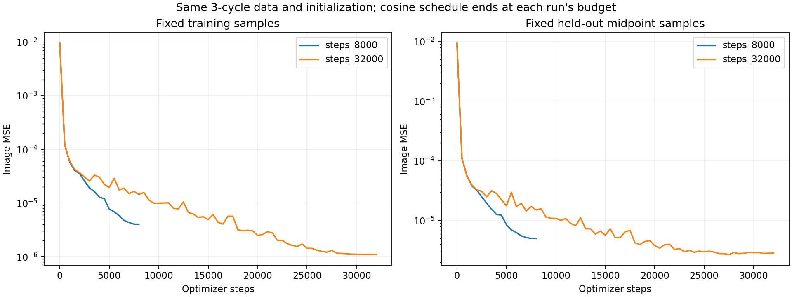

# 多周期 R=2 prototype 与训练预算

两组训练、完整网格评估及中间检查点比较均已完成。延长训练改善图像拟合，但没有恢复正确的 motion–intensity 分离。

## 配置

- 空间 64×64；保持原 dynamics 及周期 1，将时间范围从 [-0.5,0.5] 延长到 [-0.5,2.5]。
- 3 个完整共同周期；每周期 126 个时间间隔，密度为原来的两倍。周期端点共享，共 379 个训练时刻、378 个 unseen midpoints。
- Rank 2；seed 0；batch 4096；390,934 个参数；原 hash、motion、时间 MLP 容量与图像 MSE 不变。
- 两组均从头训练；8k / 32k 各自在自己的预算末尾将余弦学习率降到零，长训练不是从短训练的零学习率继续。
- 固定训练 / 验证监控样本各 65,536 个，独立 seed 2026；默认每 500 steps 记录，无放回抽样且索引在整个训练中不变。
- 验证图像、真实 motion、真实 reference intensity 不用于梯度；不按验证误差自动挑选 checkpoint。

[配置](../../../experiments/complex/low_rank_multicycle.json) · Phantom GIF (historical reference; artifact not retained) · [执行及复现命令](../../../README.md#如何运行)

## 两组最终结果

下表分支指标均为全部 378 个未见中间时刻；图像训练误差另列。RRMSE 越低越好，motion 为真实前景上的 backward endpoint RMSE。

| Steps | 训练图像 RRMSE | 未见图像 RRMSE | 未见 intensity RRMSE | 未见 motion RMSE | 前景非正 Jacobian |
|---:|---:|---:|---:|---:|---:|
| 8,000 | 2.27% | 2.46% | 63.87% | 5.473 px | 32.24% |
| 32,000 | 1.12% | 1.88% | 68.66% | 5.484 px | 32.21% |

## Loss curve 与收敛检查

| Steps | 固定训练 MSE | 固定验证 MSE |
|---:|---:|---:|
| 8,000 | 4.02896e-06 | 4.96784e-06 |
| 32,000 | 1.09396e-06 | 2.83704e-06 |

固定训练 MSE 下降约 72.85%，验证 MSE 下降约 42.89%。验证误差整体下降，末段有小幅波动，没有持续上升；训练/验证差距变大，仍存在时间插值误差。
32k 的末段趋于平台，但学习率也趋于零，因此不能把这当作完全收敛或任何更长训练都无效的证明。
每组的曲线附有所有参数组的学习率：[8k](steps_8000/plots/loss_curve.png) · [32k](steps_32000/plots/loss_curve.png)。CSV 与 SVG 同时保存。

长训练轨迹的完整网格分支检查如下；其中 8k 是 32k 学习率调度下的检查点，与独立 8k 训练不是同一个模型。

| 长训练检查点 | 未见图像 RRMSE | 未见 intensity RRMSE | 未见 motion RMSE | 前景非正 Jacobian |
|---:|---:|---:|---:|---:|
| 8,000 | 4.20% | 65.47% | 5.422 px | 30.84% |
| 16,000 | 2.51% | 69.28% | 5.483 px | 32.07% |
| 24,000 | 1.96% | 68.62% | 5.485 px | 32.37% |
| 32,000 | 1.88% | 68.66% | 5.484 px | 32.21% |

Branch convergence (historical artifact removed)

16k 到 32k，图像误差继续下降，motion 误差基本不变，intensity 误差仍约 69%。本次结果不支持将分离失败简单归因于训练 steps 不够；仅增加训练预算没有修复分离。

## 与旧单周期模型在共同未见时刻上比较

为避免训练帧密度改变造成测试时刻不一致，重新查询了第一周期内的 126 个共同未见时刻。它们没有出现在任何一组的训练时刻中。旧模型不外推到后两个周期。

| 模型 | 图像 RRMSE | Intensity RRMSE | Motion RMSE | 前景非正 Jacobian |
|---|---:|---:|---:|---:|
| 旧 1 周期 / 64 帧 / 8k | 4.01% | 46.65% | 4.780 px | 28.49% |
| 新 3 周期 / 379 帧 / 8k | 2.92% | 46.01% | 5.015 px | 32.52% |
| 新 3 周期 / 379 帧 / 32k | 2.39% | 61.48% | 5.239 px | 32.06% |

新基准在这些时刻的最终图像拟合更好，但 motion 分离没有改善；长训练的 intensity 误差反而增加。
本轮同时改变了周期数和帧密度，不能分别归因。整体时间域仍统一归一化，hash 分辨率不变，每周期占用的归一化时间范围变小。
仍是无噪声、完整图像监督、单 seed 的 toy 实验，没有 PACT 声学测量或跨周期角度变化，不能据此证明真实 object 的 rank 或重建效果。

## 动画与保存内容

| Steps | 最终图像 | Intensity 独立输出 | Motion 与真值比较 | Motion 独立作用 |
|---:|---|---|---|---|
| 8,000 | GIF (historical reference; artifact not retained) | GIF (historical reference; artifact not retained) | GIF (historical reference; artifact not retained) | GIF (historical reference; artifact not retained) |
| 32,000 | GIF (historical reference; artifact not retained) | GIF (historical reference; artifact not retained) | GIF (historical reference; artifact not retained) | GIF (historical reference; artifact not retained) |

`motion_effect.gif` 左侧为真实运动下的真实 object，右侧预测图只替换 motion，两侧共享相同的真实时变 intensity；第三列为误差。
`motion_only.gif` 则冻结学习 intensity 在参考时刻，左侧刻意固定，第三列为运动引起的变化，不是真值误差。

每组保存 config、源码快照、model、loss CSV/PNG/SVG、固定监控样本索引、最终完整指标和原始预测。中间 checkpoint 包含模型、Adam、scheduler 和 Torch RNG 状态。

## 验证

- 53 项单元测试通过；三周期 midpoint 与 block split 的小规模端到端检查通过。
- 监控开关不改变同一训练的权重、梯度路径或 Torch 采样状态。两组正式实验配置仅 steps 和 checkpoint 列表不同，初始固定样本 loss 完全相同。
- 两个训练后模型均在 4,096 个参考坐标上严格满足 u(t0)=0；511 个重载抽样预测与保存数组完全一致；坐标梯度有限且空间梯度非零。
- 两组 intensity 的 rank-2 后相对 Frobenius 尾部约 3.5e-8，符合 float32 数值精度。源码快照各 43 个文件通过 SHA256 校验。
- [完整指标与比较来源](comparison.json) · [检查点指标](checkpoint_metrics.json) · [验证记录](verification.json) · [测试日志](validation.log)。
